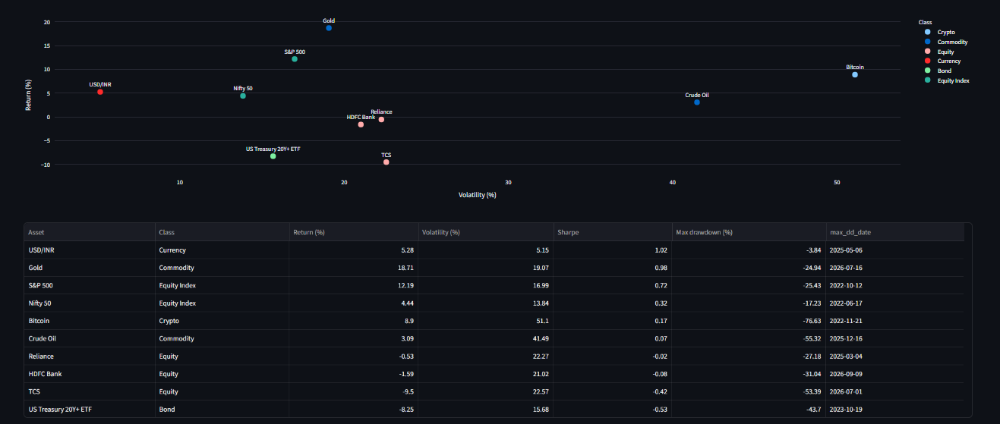

# Multi-Asset Market Analytics

A dashboard that puts equities, commodities, currency, crypto and bonds on one risk-adjusted scale, with an automated data-quality layer that checks whether the data can be trusted.

Built with **Python, SQLite (SQL), pandas, yfinance and Streamlit**. Author: Neha.



---

## Customer and problem

**Customer:** a retail investor or junior portfolio analyst who wants to compare assets from different markets.

**Problem:** returns, risk and data reliability usually sit in separate tools. Assets are priced in different currencies, trade on different calendars, and vendor data can be silently wrong. It is hard to see which asset actually paid for the risk it carried, and whether the numbers behind that answer are reliable.

**What this project does about it:** one dashboard that compares 10 instruments across 5 asset classes on annualized return, volatility, Sharpe ratio, maximum drawdown and correlation, plus a "Data Health" tab that shows what the automated checks found.

## Instruments

| Asset class | Instruments |
|---|---|
| Equity indices | Nifty 50 (`^NSEI`), S&P 500 (`^GSPC`) |
| Commodities | Gold futures (`GC=F`), WTI crude oil futures (`CL=F`) |
| Currency | USD/INR (`INR=X`) |
| Crypto | Bitcoin (`BTC-USD`) |
| Bonds | iShares 20+ Year Treasury ETF (`TLT`) |
| Indian large caps | TCS (`TCS.NS`), HDFC Bank (`HDFCBANK.NS`), Reliance (`RELIANCE.NS`) |

Five years of daily prices, adjusted for splits and dividends (window: 8 Oct 2021 to 8 Oct 2026).

## Dashboard tabs

1. **Asset Class Overview:** rebased price history (start = 100) with a look-back slider, and average daily return by asset class computed in SQL.
2. **Risk & Return:** risk/return scatter, ranked table of annualized return, volatility, Sharpe and maximum drawdown, and a drawdown chart per asset.
3. **Correlation:** return correlation heatmap with a daily/weekly switch.
4. **Stock Fundamentals:** P/E, ROE and leverage for TCS, HDFC Bank and Reliance, with a SQL ranking.
5. **Data Health:** results of the automated data-quality checks.

## Insights

All figures below come from this project's own output for 8 Oct 2021 to 8 Oct 2026.

**1. Gold earned far more per unit of risk than the Nifty 50, but did not protect better in a drawdown.**
Gold returned 18.8% a year with 19.1% volatility and a Sharpe ratio of 0.99. The Nifty 50 returned 4.7% with 13.8% volatility and a Sharpe of 0.34. Gold's maximum drawdown (-24.9%, trough July 2026) was deeper than the Nifty's (-17.2%, trough June 2022), and almost the same as the S&P 500's (-25.4%). Gold is priced in USD and the Nifty in INR, and the window includes a strong gold run, so this should not be read as a permanent rule.

**2. Bitcoin paid less than the S&P 500 for roughly three times the risk.**
Bitcoin returned 8.8% a year against 12.2% for the S&P 500, with 51.1% volatility against 17.0% (a ratio of 3.0), a maximum drawdown of -76.6% against -25.4%, and a Sharpe ratio of 0.17 against 0.72. The result is sensitive to the window: it begins on 8 Oct 2021 (first close $53,968), includes the 2022 drawdown (trough 21 Nov 2022), and contains the window's highest close, $124,753 on 6 Oct 2025.

**3. Same-day correlations between regions understate how connected markets are.**
The Nifty 50 and the S&P 500 show a daily return correlation of only 0.19, rising to 0.43 on weekly returns. This is consistent with the two markets closing at different times, though weekly returns also smooth out noise, so the timing explanation is a hypothesis rather than a proven cause. Gold and long-dated Treasuries were weakly correlated with the S&P 500 on both horizons (gold 0.11 daily / 0.16 weekly; TLT 0.09 / 0.13). One result went the other way: Bitcoin's correlation with the S&P 500 fell from 0.42 daily to 0.28 weekly. I did not investigate why.

## Corporate finance comparison

| | P/E | ROE | Debt / equity | Equity multiplier |
|---|---|---|---|---|
| TCS | 15.1 | 45.9% | 0.11 | 1.7 |
| HDFC Bank | 15.4 | 13.0% | n/a (bank) | 8.4 |
| Reliance | 21.9 | 8.9% | 0.44 | 2.4 |

- TCS combines the highest ROE with the lowest leverage and the lowest P/E of the three.
- **Banks are not ranked on debt/equity.** A bank funds itself with customer deposits, so debt/equity is not meaningful for HDFC Bank; it is compared on equity multiplier (total assets / equity) instead, and ranked only on ROE.
- P/E is the vendor's trailing figure as of 8 Oct 2026. ROE and leverage are computed from the fiscal year ended 31 Mar 2026, using year-end equity.

## Data quality and validation

- **SQL checked against pandas.** The average daily return for gold matches exactly (0.07486%). The 30-day volatility differs by the expected factor of sqrt(29/30): 19.46% in SQL (population standard deviation) against 19.80% in pandas (sample standard deviation).
- **Unit tests** cover maximum drawdown, volatility and CAGR on hand-calculated cases (`tests/test_metrics.py`). The drawdown function also reproduces the troughs of known market events (S&P 500 in October 2022, Bitcoin in November 2022).
- **Automated checks** (`checks.py`) test for stale data, date gaps, flat prices and large daily moves, and write the results to a `data_quality` table that the dashboard reads. The run found no stale data, gaps or flat prices, and flagged 10 large daily moves. Five are annotated with the event behind them and five are still marked `review`. The 8 April 2026 oil drop (-16.4%) was confirmed against a second source: a news report gave the same closing price for the May WTI contract that is stored in the database, and a persistence test showed the price stayed at the new level rather than snapping back.
- **HDFC Bank reconciliation.** Vendor statement equity (about Rs 8.17 trillion) and total assets (about Rs 52.6 trillion) disagreed with the bank's audited FY26 consolidated results (shareholders' equity Rs 5.86 trillion, total assets Rs 49.1 trillion). I used the audited figures and documented the override in `config.py`, with the source recorded in the `fundamentals` table. My first attempt used total equity including minority interest and understated ROE, because it did not match the profit measure (profit after minority interest). The corrected ROE is 13.0% on year-end equity and 13.7% on average equity, consistent with the vendor's own 13.8%.
- **Null-safe ranking.** An early version of the ROE/leverage ranking gave missing values the best rank, because SQLite sorts `NULL` first. The query now ranks only real values.

## Assumptions and limitations

- Sharpe ratio uses a **0% risk-free rate**. Volatility is annualized with 252 trading days (365 for Bitcoin, which trades every day). Annualized return is CAGR.
- **Returns are in each asset's local currency** (USD for the S&P 500, gold and Bitcoin; INR for the Nifty and Indian stocks). USD/INR is an exchange rate, so its "return" is rupee depreciation, not an investment return.
- Gold and oil are **continuous futures series** and can show jumps when contracts roll.
- **Fundamentals are a single snapshot**, not a history. Only the three stocks have fundamentals.
- Returns are computed on each asset's own trading days. Correlations use pairwise overlapping days and need at least 250 daily or 100 weekly overlaps.
- Same-day correlations between regions are affected by different market close times.
- Price data comes from yfinance (Yahoo Finance), an unofficial source, so numbers shift slightly each time the data is refreshed.

## Project structure

```
market-analytics/
├── config.py            # instruments, assumptions, documented overrides
├── etl.py               # extract from yfinance, load into SQLite
├── queries.sql          # 5 analytical SQL queries and the daily-returns view
├── run_queries.py       # runs the SQL queries from Python
├── metrics.py           # CAGR, volatility, Sharpe, drawdown, correlation
├── checks.py            # automated data-quality checks
├── app.py               # Streamlit dashboard (5 tabs)
├── tests/               # unit tests
└── scripts/             # one-off investigation and verification scripts
```

The database has four tables: `assets`, `prices`, `fundamentals` and `data_quality`.

The five SQL queries use window functions (`LAG`, `ROW_NUMBER`, `RANK`, a rolling-window volatility built from `AVG` over a 30-row frame) and joins:

1. average daily return by asset class
2. monthly returns using `LAG`
3. best and worst 5 days per asset
4. rolling 30-day annualized volatility
5. ROE ranking, with leverage ranking for non-banks only

## Run it

```bash
python -m venv .venv
.venv\Scripts\activate          # on Mac/Linux: source .venv/bin/activate
pip install -r requirements.txt

python etl.py                   # pull prices and fundamentals into market.db
python checks.py                # run data-quality checks
streamlit run app.py            # open the dashboard
python -m pytest                # run the tests
```

## Next feature

A **portfolio builder**: the user sets weights across the instruments and sees the portfolio's return, volatility, drawdown and the diversification benefit implied by the correlation matrix. The dashboard compares assets one at a time, but an investor's real question is how assets behave together, and the correlation and risk code already exists to answer it.

A second candidate is cross-checking prices against a second data source, so that the data-quality layer can catch vendor errors like the HDFC Bank one automatically instead of through manual investigation.
